# Adopter Admin Guide

Set up, onboard, and operate AI4I Orchestrate · Version 1.0

### Part I — Plan & Prepare

*Understand your role, review the key terms, and gather what you need for setup.*

## 1. Introduction

### About AI4I Orchestrate

AI4I Orchestrate provides a single platform for secure, controlled use of hosted AI models at scale. Organizations can offer open-source and other hosted models to institutions and their applications while retaining control over access and the underlying AI infrastructure.

It brings access controls, usage tracking, and operational monitoring together, so organizations can manage model use, measure consumption, and maintain accountability across institutions and applications.

### Purpose of this Guide

Follow Part II for initial setup. Use Parts III and IV to monitor the platform and carry out day-to-day tasks:

- **Part II — Set Up & Onboard:** sign in, register models, configure tiers and services, and onboard institutions with a tier and budget.
- **Part III — Monitor & Track:** monitor platform performance and track budget and usage.
- **Part IV — Manage & Maintain:** manage access, update configurations, and maintain the platform after setup.

### Intended Audience

This guide is for you as the **Adopter Admin** responsible for AI4I Orchestrate in your organization. It covers registering models, configuring tiers and services, onboarding institutions, and monitoring platform health, budgets, and usage.

## 2. Before You Begin

### Roles & Responsibilities

**Adopter Admin —** you govern the platform for your organization. You register models, configure tiers and services, onboard institutions, and monitor platform health, budgets, and usage.

**Adopter User —** a member of your organization who can explore available models in the portal. You can add the user, or they can register themselves.

**Institution Admin —** creates applications and API keys for their institution, adds its users, and tracks its budget and usage against the assigned tier.

You onboard the institution and assign its tier and budget. The Institution Admin manages access and usage within those limits.

**Institution User —** a user added by an Institution Admin who can sign in and explore available models in the portal.

### Information to Keep Ready

Have the following ready before you start:

- Your sign-in credentials, shared with you by your Implementation team.
- The models you want to offer, each hosted and reachable on your infrastructure.
- The quota and rate limit for each tier you plan to create.
- The institutions to onboard, with each organization’s name and primary contact’s name and email address. A phone number is optional.
- The tier and budget you intend to assign each institution.

### Readiness Checklist

Check each item before starting Part II so you have the details needed at each step. Your checklist progress is saved automatically.

- [ ] You have received your Adopter Admin credentials.

- [ ] The admin portal’s sign-in page opens in a supported browser.

- [ ] Each model you plan to offer is hosted and running on your infrastructure.

- [ ] You have each model’s endpoint and have confirmed that the platform can reach it.

- [ ] You have prepared one JSON file per model using the template in Model Management.

- [ ] You have decided the quota for each model task type and the rate limit for each tier. You can configure the rate limit in the tier form.

- [ ] For each service, you have decided the unit size, applicable prices, and currency. For LLM services, prepare separate input, cached input, and output token prices. You also have its hardware description and authentication token if the model requires one.

- [ ] You have identified the institutions to onboard.

- [ ] For each institution, you have its organization name and primary contact’s name and email address. A phone number is optional.

- [ ] You have chosen the tier to assign to each institution.

- [ ] You have decided each institution’s budget and its Effective From and Effective To dates.

- [ ] You have received the Grafana link and sign-in credentials from your Implementation team.

## 3. Key Terms

The following terms are used throughout this guide.

| Term | Definition |
| --- | --- |
| Adopter | The organization that deploys and governs an AI4I Orchestrate instance. It hosts models and onboards institutions that use them. |
| Institution | An organization onboarded by the adopter to use its hosted models. It receives a tier and budget and registers applications that operate within those limits. |
| Application | A solution built by an institution to use models through an API key. An institution can register one or more applications. |
| API Key | A credential an institution creates for an application to authenticate its requests to models. |
| Service | A configuration that connects a registered model to its hosted endpoint, pricing, and permitted tiers. A model can have more than one service. |
| Tier | A named set of usage limits assigned to an institution, with quotas for the model task types it covers and a configurable request rate limit. |
| Budget | A monetary spending limit assigned to an institution along with its tier. The Effective From and Effective To dates define when it applies.The budget limits spend independently of the institution’s remaining quota. |
| Quota | The maximum amount of model usage an institution can consume each month, set for each model task type on its tier.Quotas support fair access to shared resources, prevent excessive use, and keep consumption within assigned limits. They reset automatically at the start of each month. |
| Rate Limit | The maximum number of requests allowed within a specified time period. In the tier form, the rate limit is configured as requests per minute.Quota limits total monthly usage. Rate limits control how quickly requests are sent, helping protect platform stability and maintain fair access. |
| Metering | The recording of model usage across institutions, including the combined usage of each institution’s applications. Usage is tracked against the institution’s assigned budget. |
| Monitoring | The ongoing tracking of platform and application performance, including response time, error rates, request and response sizes, and CPU, memory, and disk usage.Monitoring is part of the Adopter Admin’s responsibilities. |

### Part II — Set Up & Onboard

*Register models, configure tiers and services, and onboard institutions.*

## 4. Getting Started

- **Objective:** Sign in to AI4I Orchestrate and open the Usage Dashboard.

- **Role:** Adopter Admin

- **Prerequisites:** AI4I Orchestrate has been deployed, and your Implementation team has shared your Adopter Admin credentials.

- **Step 1** On the sign-in page, enter your email address and password, then click **Sign In**. If your admin account uses the same email address as your Google account, you can also click **Sign in with Google**.

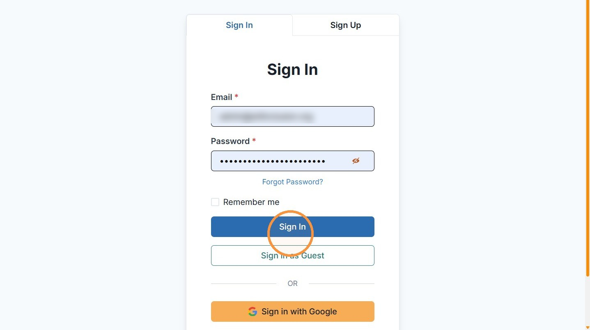

*The AI4I Orchestrate sign-in page.*

- **Step 2** Once you sign in, you will see the **Usage Dashboard**, the landing page for the admin portal.

*The Usage Dashboard after sign-in.*

- **Outcome:** You are signed in and ready to begin setup. For a new deployment, start by registering the models you want to offer, then configure the tiers, services, institutions, and budgets.

- **Next:** Continue to Register a Model.

## 5. Register a Model

- **Objective:** Register a hosted model so you can create a service for it.

- **Role:** Adopter Admin

- **Prerequisites:** The model is hosted and running on your infrastructure. Hosting is managed outside AI4I Orchestrate.

- **Step 1** In the left navigation, click **Model Management**.

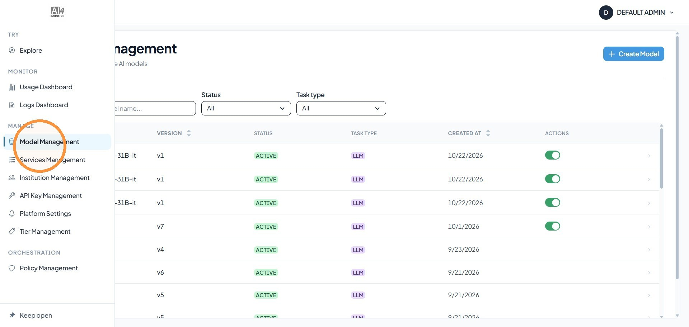

*The Model Management page.*

- **Step 2** Click **Create Model** to open the form.

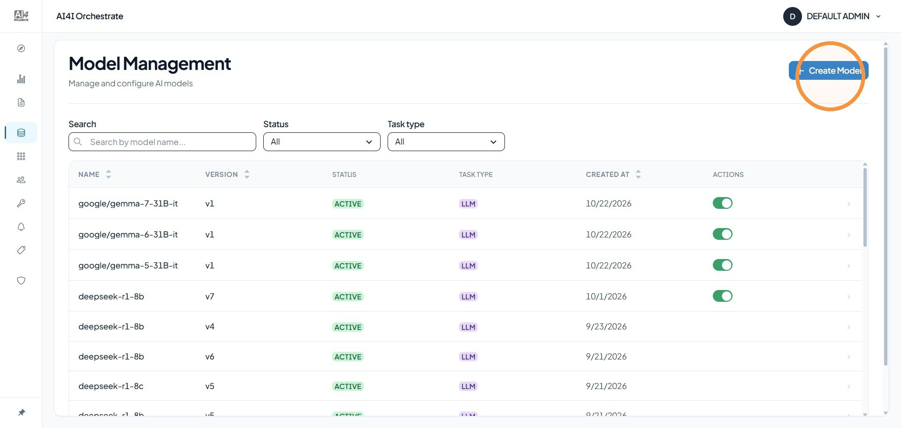

*The Create Model button.*

- **Step 3** Click **Download Sample JSON**. You will use this template to enter the model’s details.

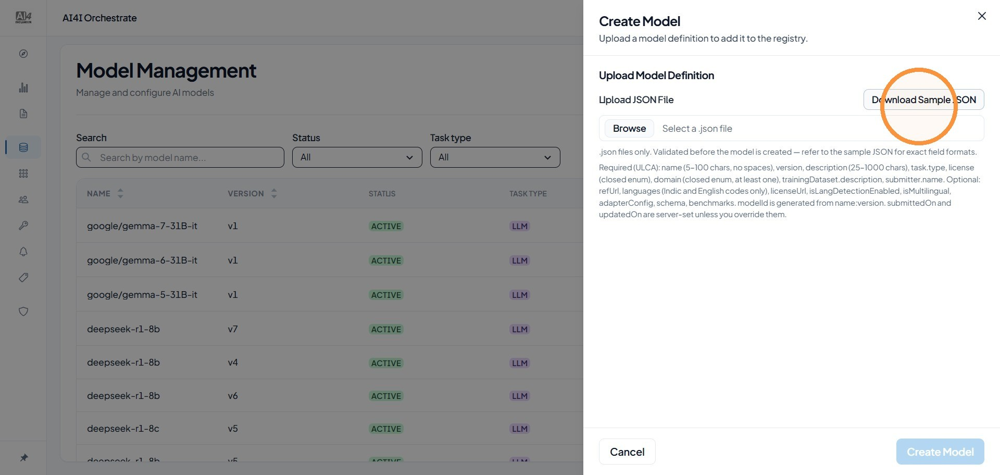

*The Download Sample JSON option.*

- **Step 4** Open the downloaded JSON file and fill in the model’s details.

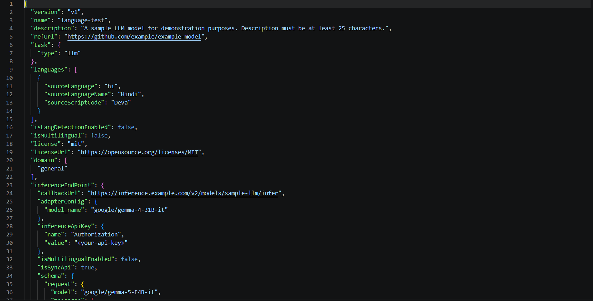

*The JSON template with the model’s details.*

- **Step 5** Under **Upload JSON File**, click **Browse** and select your completed file.

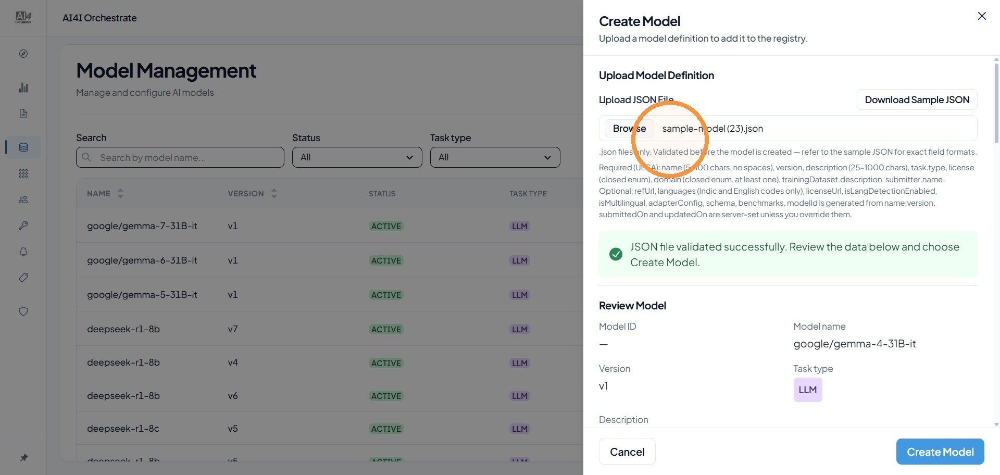

*The uploaded JSON file and model details ready for review.*

- **Step 6** The platform checks the uploaded file against the required schema and shows an error if any details need to be corrected. Once validation succeeds, review the model details, then click **Create Model**.

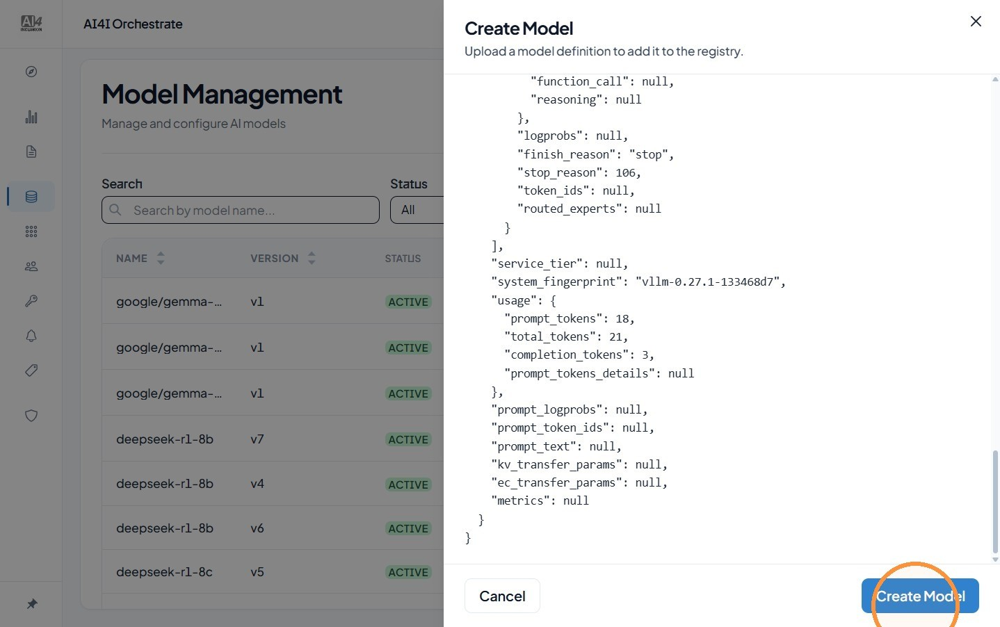

*The Create Model button used to submit the validated file.*

- **Outcome:** After the model is created successfully, it appears in Model Management with its version, task type, and status. To make it available to institutions, create and publish a service for it.

- **Next:** Continue to Configure a Tier.

## 6. Configure a Tier

- **Objective:** Create a tier that sets how much model usage an institution is allowed.

- **Role:** Adopter Admin

- **Prerequisites:** The relevant model is registered on the platform.

- **Step 1** In the left navigation, click **Tier Management**.

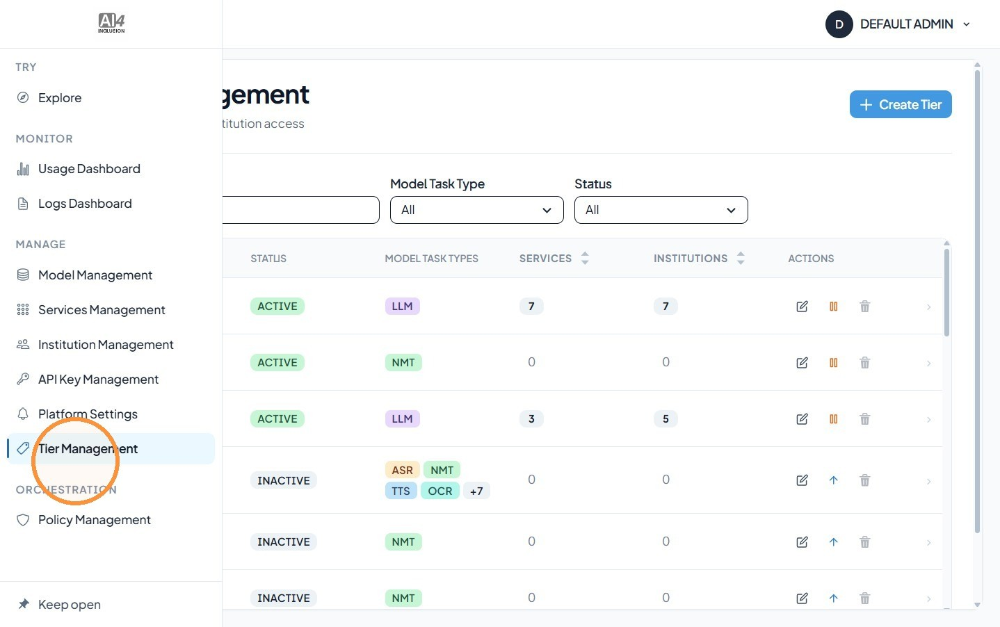

*The Tier Management page.*

- **Step 2** Click **Create Tier** to open the form.

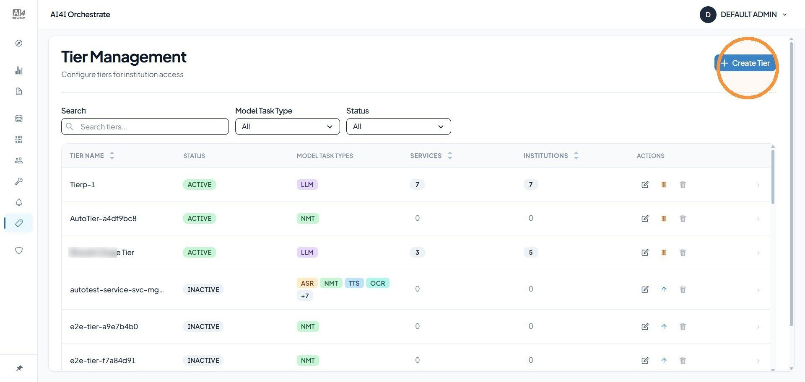

*The Create Tier button.*

- **Step 3** Enter a **Tier Name** and **Description**. Set the **Rate Limit (per minute)**, the number of requests allowed per minute across inference APIs, or leave it empty to use the platform default. Then select the **Model Task Type**, such as LLM. The **Unit** is filled in automatically for the Model Task Type you select.

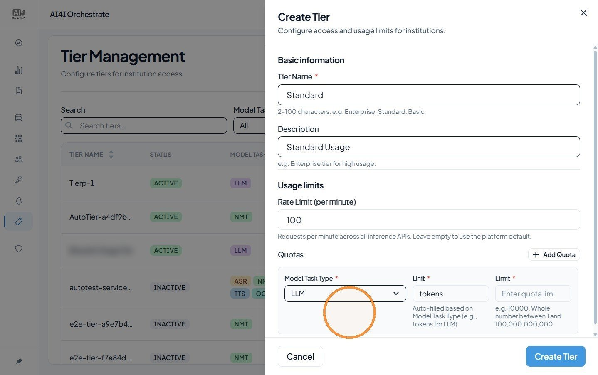

*The tier details, rate limit, and selected model task type.*

- **Step 4** In **Limit**, enter the quota for the selected **Model Task Type**. To add a quota for another task type, click **Add Quota** and complete the new row.

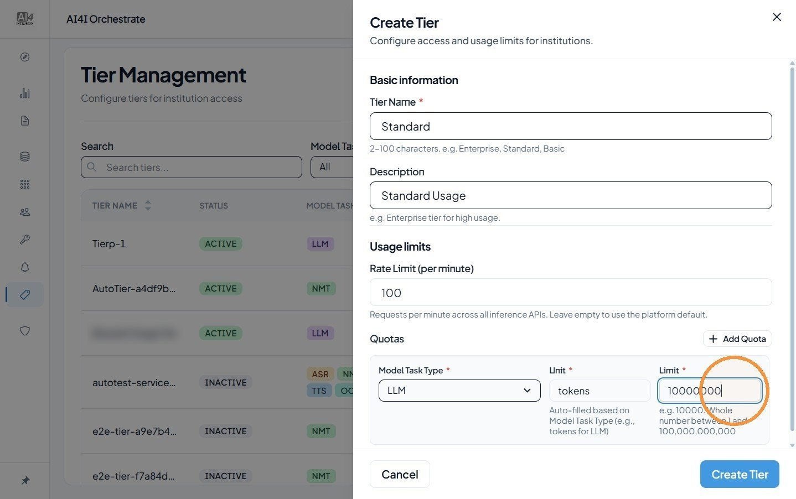

*The quota limit for the selected Model Task Type.*

- **Step 5** Click **Create Tier** to save the tier.

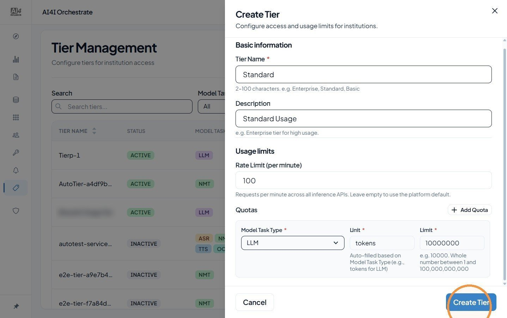

*The completed tier, ready to create.*

- **Step 6** The new tier appears in the list with **Inactive** status. Click the **Activate** icon in its **Actions** column.

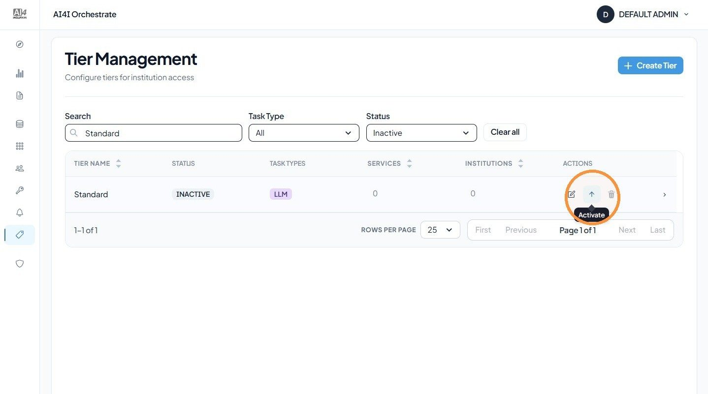

*The Activate action for a new tier with Inactive status.*

- **Step 7** In the confirmation dialog, click **Activate**.

*The Activate Tier confirmation.*

- **Outcome:** The tier appears in Tier Management with **Active** status and the model task types it covers. You can now select this tier when you create a service.

- **Next:** Continue to Create Service and Configure Pricing.

## 7. Create Service and Configure Pricing

- **Objective:** Create a service by connecting a registered model to its endpoint, setting its price, and choosing the tiers that can access it.

- **Role:** Adopter Admin

- **Prerequisites:** The model is registered, at least one tier exists, and the platform can reach the endpoint where the model is hosted.

- **Step 1** In the left navigation, click **Services Management**.

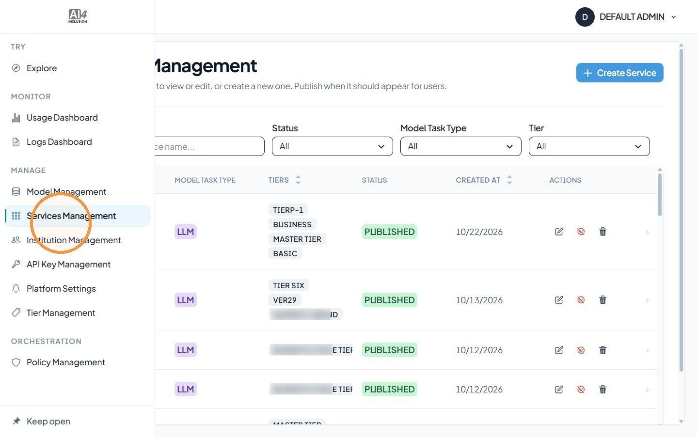

*The Services Management page.*

- **Step 2** Click **Create Service** to open the form.

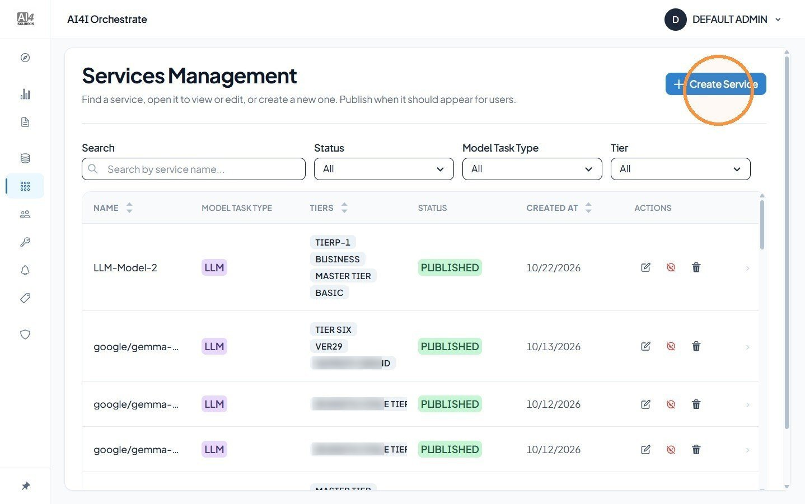

*The Create Service button.*

- **Step 3** Select the **Model Task Type**, such as LLM, and the **Model Name**. The **Model ID** and **Model Submission Date** are filled in automatically.The **Service ID** starts with the model name. Complete the ID, then enter a **Service Description**.

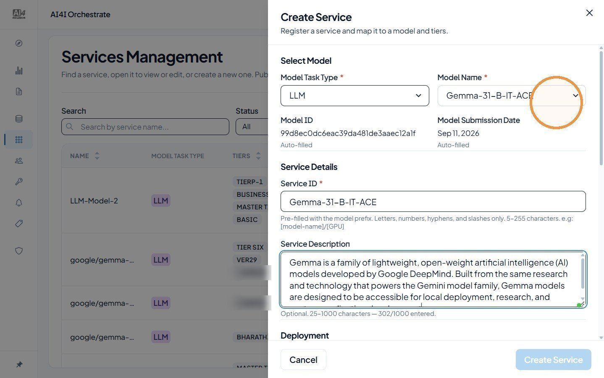

*The selected model and service details.*

- **Step 4** Enter the **Endpoint** where the model is hosted. If the model requires authentication, enter its **Authentication Token**. Add a **Hardware Description**, such as NVIDIA: RTX 3090.The **Unit Type** is filled in automatically for the selected Model Task Type, such as tokens for LLM. Select the **Unit Size**. For LLM services, enter the **Input Token Price**, **Cached Input Token Price**, and **Output Token Price** for that unit size. All three prices are required and can be zero. For other task types, enter the **Price per unit size**. Select the **Currency**. The default currency is INR.Select at least one **Tier** that should have access to the service, then click **Create Service**.

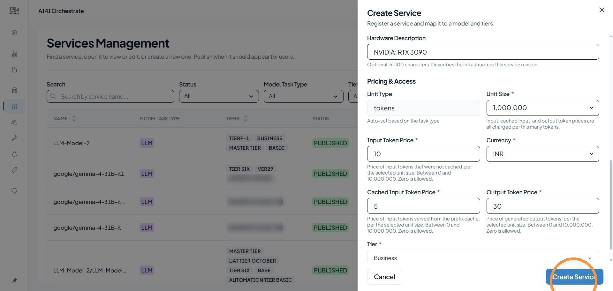

*The hardware description, token pricing, currency, and tier settings.*

- **Outcome:** The service is created for the selected model and is unpublished by default. Publish it from Services Management to make it available to institutions.

- **Next:** Continue to Onboard an Institution.

## 8. Onboard an Institution

- **Objective:** Add an institution to the platform so you can assign its tier and budget.

- **Role:** Adopter Admin

- **Prerequisites:** You have the institution’s organization name and its primary contact’s name and email address. A phone number is optional.

- **Step 1** In the left navigation, click **Institution Management**.

*The Institution Management page.*

- **Step 2** Click **Create Institution** to open the form.

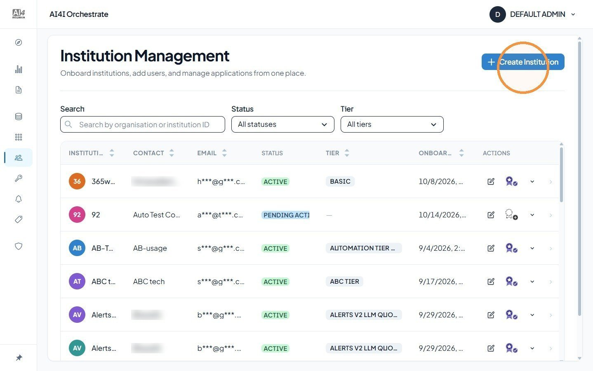

*The Create Institution button.*

- **Step 3** Enter the **Organisation**, **Contact Name**, and **Email**. Add a **Phone Number** if available, then agree to the **Terms of Service** and **Privacy Policy**. Review these documents before selecting the agreement checkbox.

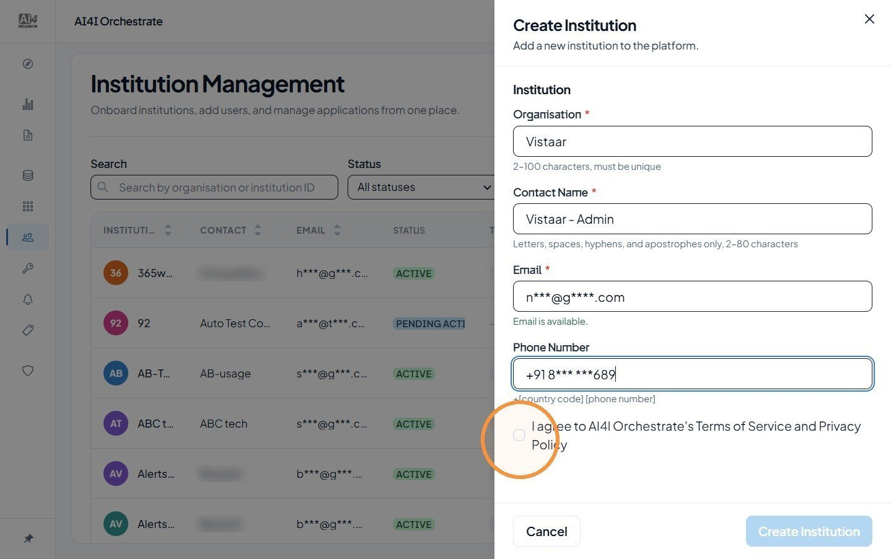

*The institution details and policy agreement.*

- **Step 4** Click **Create Institution** to add the institution.

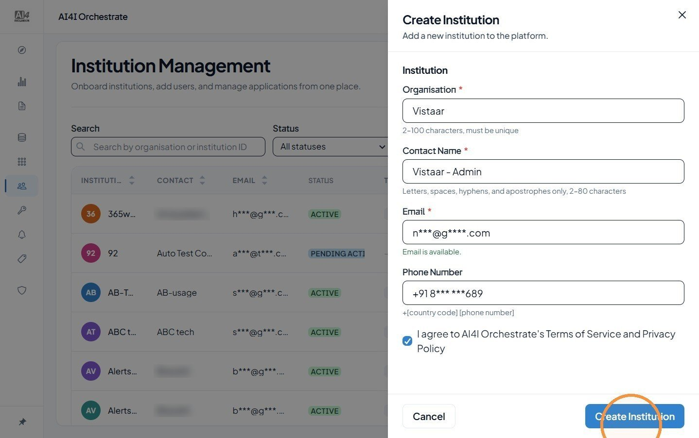

*The completed form, ready to create the institution.*

- **Step 5** Return to **Institution Management** and check that the institution appears in the list with its current status.

- **Outcome:** The institution is created and appears in Institution Management. Next, assign a tier and budget so its Institution Admin can manage applications and API keys within those limits.

- **Next:** Continue to Assign Tier & Allocate Budget.

## 9. Assign Tier & Allocate Budget to an Institution

- **Objective:** Assign an institution a tier and budget so it can access models within the limits you set.

- **Role:** Adopter Admin

- **Prerequisites:** The institution is onboarded, and at least one tier has a published service mapped to it.

- **Step 1** In the left navigation, click **Institution Management**.

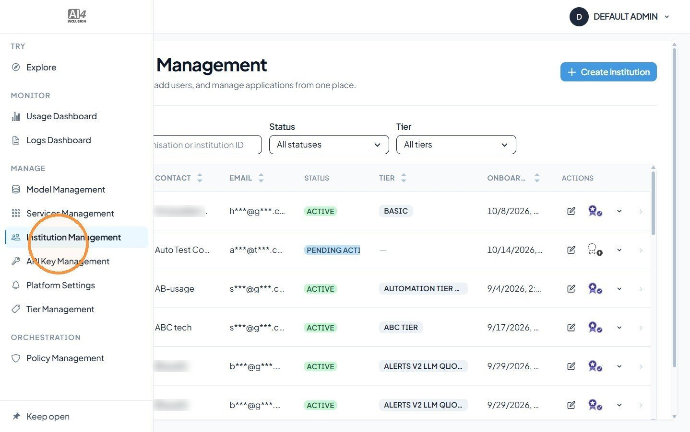

*The Institution Management page.*

- **Step 2** Find the institution in the list. In its **Actions** column, click the **Assign Tier** icon.

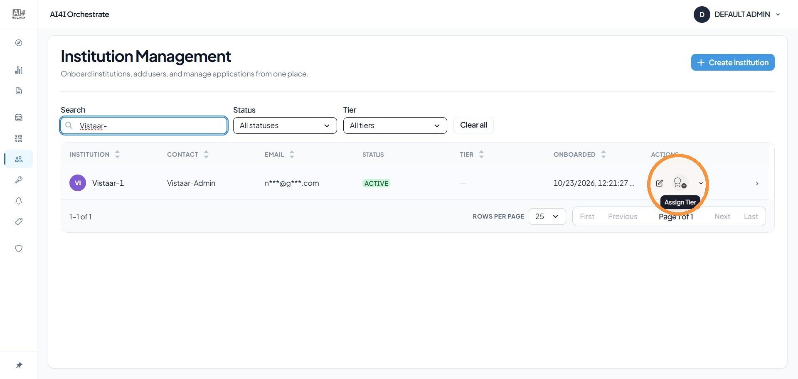

*The Assign Tier action for an institution.*

- **Step 3** Select the **Tier**, enter the **Budget**, and set the **Budget Effective From** and **Budget Effective To** dates.

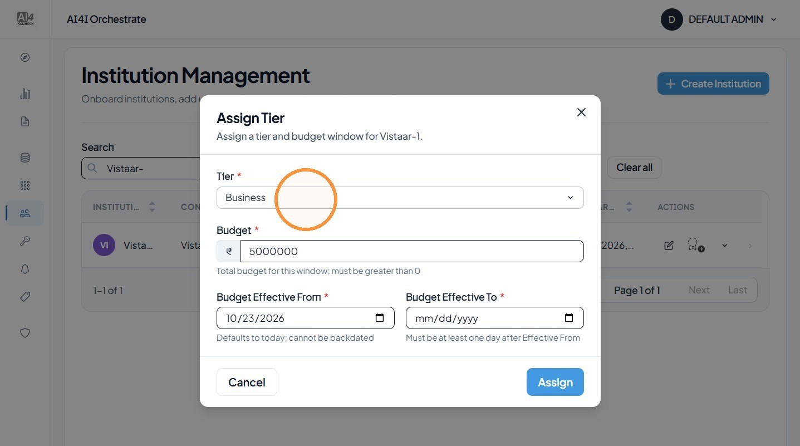

*The Assign Tier form with fields for tier, budget, and effective dates.*

- **Step 4** Click **Assign** to save the tier and budget for this institution.

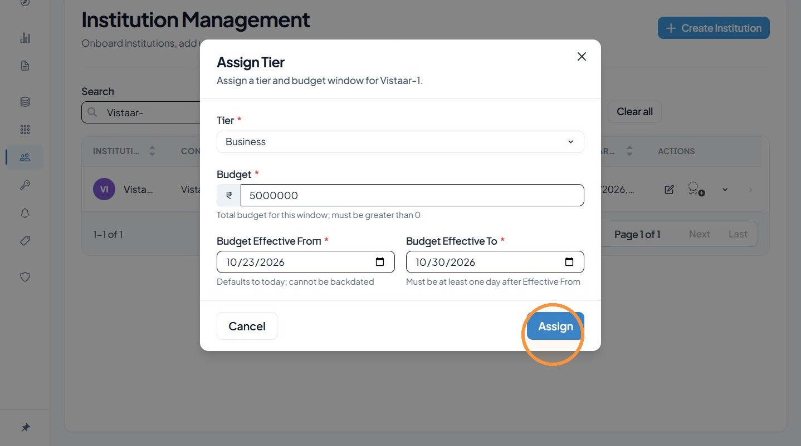

*The tier and budget assignment, ready to save.*

- **Outcome:** The institution now has an assigned tier and budget. Its Institution Admin can create applications and API keys to access models within the tier’s quotas and the allocated budget.

- **Next:** Continue to Part III to monitor platform performance and track usage.

### Part III — Monitor & Track

*Monitor platform performance and track budget and usage across institutions.*

## 10. Monitoring Dashboard

- **Objective:** Check platform health and performance using the Grafana dashboards provided with your deployment.

- **Role:** Adopter Admin

- **Prerequisites:** You have the Grafana link and your sign-in credentials.

- **Step 1** Open the Grafana link shared by your Implementation team. Enter your credentials, then click **Log in**.

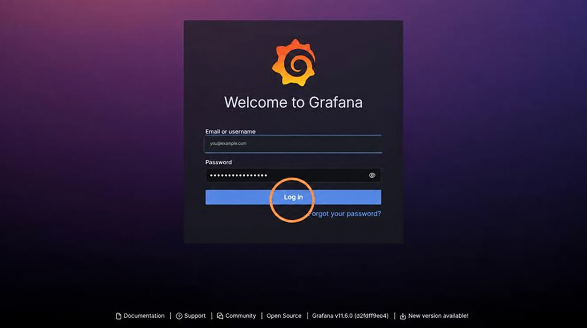

*The Grafana sign-in page.*

- **Step 2** Once you sign in, click **Dashboards** to see the available dashboards.

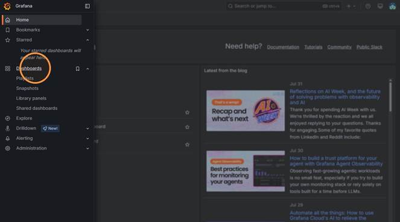

*The Dashboards menu in Grafana.*

- **Step 3** Click **AI4ICore LLM Operations Dashboard** to view latency, errors, and payload size for LLM requests across the platform.

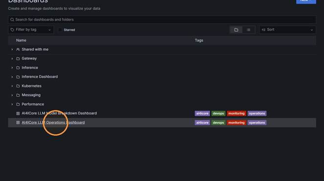

*The list of available dashboards.*

- **Step 4** Choose the time range and refresh interval you want to use. The dashboard shows **Latency**, **Payload Size**, **Error Rate**, and **Error Breakdown by Status Code** for the selected period.

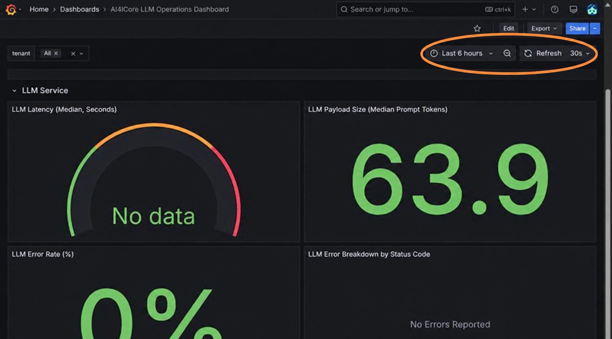

*The LLM Operations Dashboard and time-range controls.*

- **Step 5** Click **Pod Resources — Service-aware** to view CPU, memory, and disk usage by service.

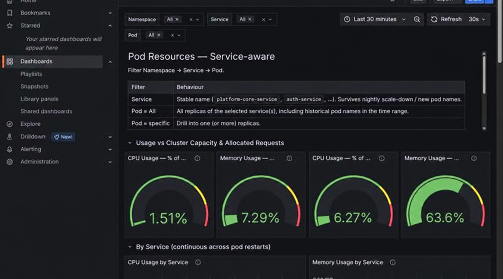

*CPU, memory, and disk usage in the Pod Resources dashboard.*

- **Outcome:** You can review request performance in the LLM Operations Dashboard and resource usage in the Pod Resources dashboard.

- **Next:** Continue to the Usage Dashboard.

## 11. Usage Dashboard

- **Objective:** Review platform-wide metrics and track usage and spending by institution, model, service, and application.

- **Role:** Adopter Admin

- **Prerequisites:** At least one institution with an assigned tier and budget is using a published service.

- **Step 1** In the left navigation, click **Usage Dashboard**.

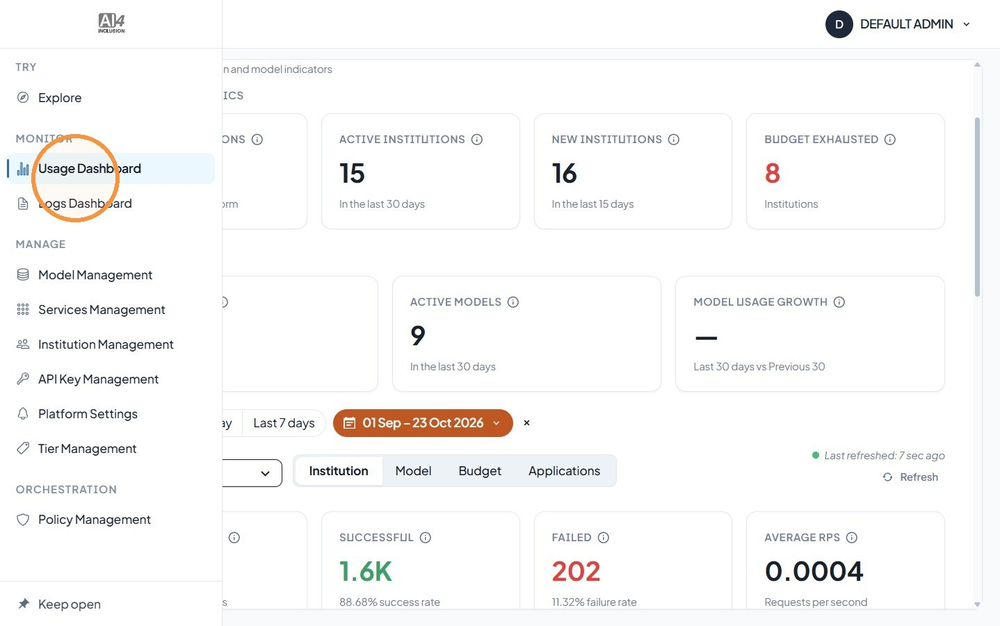

*The Usage Dashboard.*

- **Step 2** Start with **Key metrics** to see the platform-wide institution and model indicators. Use the date range to filter **Institution** and **Model** data. **Key metrics**, **Budget**, and **Applications** are independent of this date filter. Use the institution filter to select the institution you want to review.

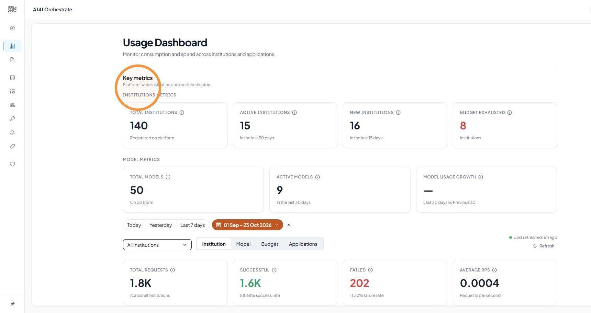

*Platform-wide institution and model indicators in Key metrics.*

- **Step 3** Click the **Institution** tab to review request activity across institutions: total requests, successful and failed requests, and average requests per second (RPS). **Usage Concentration** ranks institutions by request volume, so you can see which institutions account for the most usage.

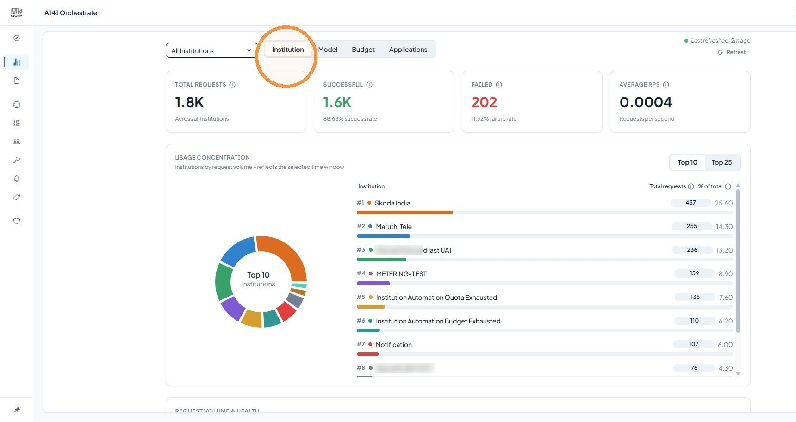

*Usage Concentration in the Institution tab.*

- **Step 4** Click the **Model** tab to review model usage and request performance across institutions for the selected time range. You can see the overall success rate and the most-used model. **Model Consumption** ranks models by request volume, helping you compare demand across models.

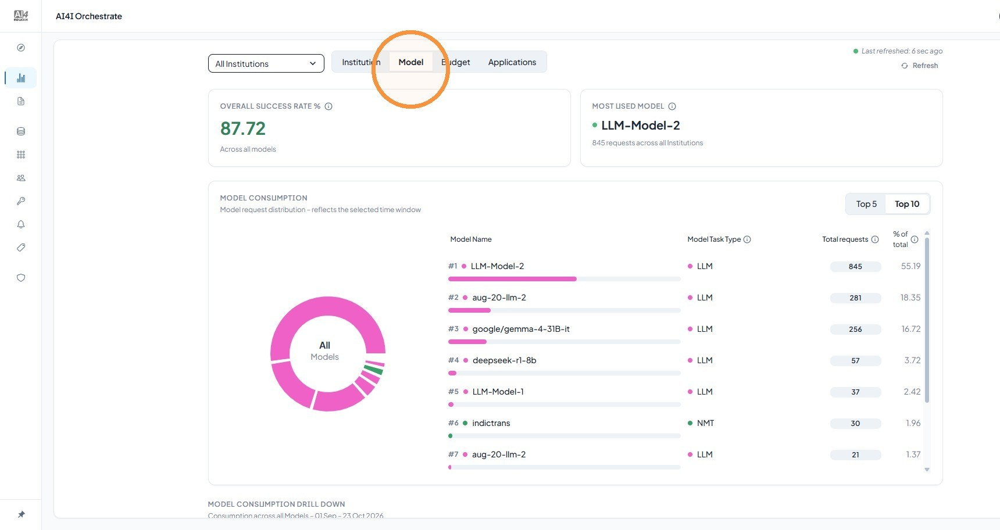

*Model Consumption in the Model tab.*

- **Step 5** Scroll down to **Model Consumption Drill Down** to see total requests, native consumption, and success rate for each model and service. Use the **Model Task Type** filter to narrow the results.

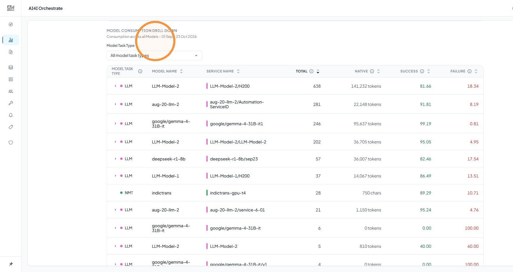

*Usage by model and service in Model Consumption Drill Down.*

- **Step 6** Click the **Budget** tab to compare each institution’s spend with its allocated budget. Each row also shows the institution’s assigned tier and the amount still available. Use **Filter by tier** to view institutions on a particular tier. Institutions that have exceeded their budget are flagged.

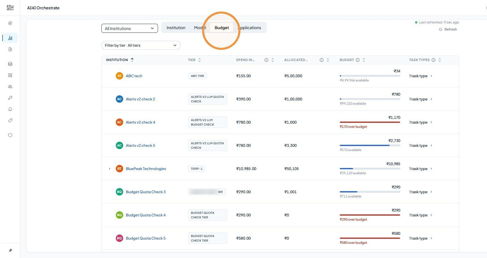

*Institution budgets and spending in the Budget tab.*

- **Step 7** Click the **Applications** tab to view usage by application across institutions.

- **Outcome:** You can review platform-wide activity in Key metrics, compare usage in the Institution and Model tabs, check spending in the Budget tab, and view application usage in the Applications tab.

- **Next:** Continue to Part IV for day-to-day management and maintenance.

### Part IV — Manage & Maintain

*Manage your institutions, applications, API keys, tiers, models, services, users, and profile.*

## 12. Manage Institutions

- **Objective:** Suspend an institution, reactivate a suspended institution, or deactivate it.

- **Role:** Adopter Admin

- **Prerequisites:** The institution is already onboarded.

- **Step 1** In the left navigation, click **Institution Management**.

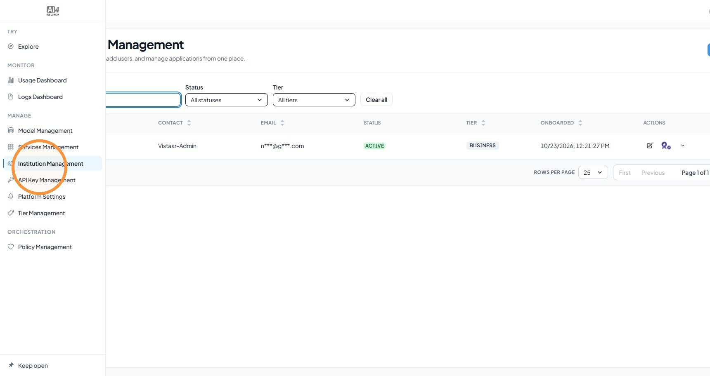

*The Institution Management page.*

- **Step 2** Find the institution you want to suspend. Open its **Actions** dropdown, then click **Suspend**.

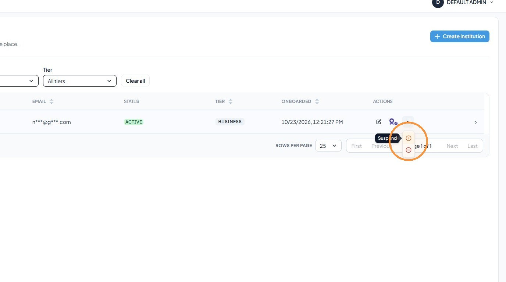

*The Suspend action for an institution.*

- **Step 3** In the confirmation dialog, click **Update** to suspend the institution.

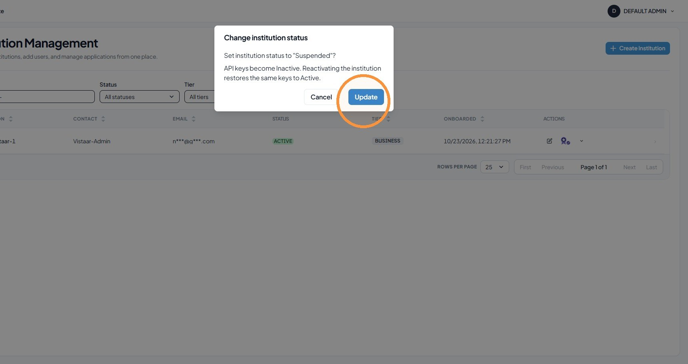

*The suspension confirmation.*

- **Step 4** To reactivate a suspended institution, open its **Actions** dropdown and click **Activate**.

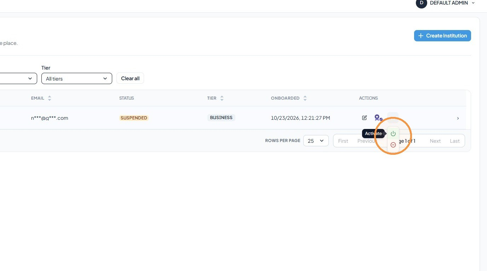

*The Activate action for a suspended institution.*

- **Step 5** In the confirmation dialog, click **Update** to reactivate the institution.

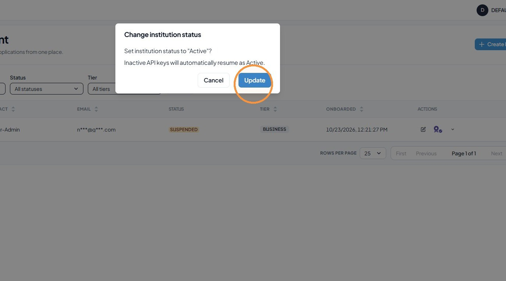

*The activation confirmation.*

- **Step 6** To deactivate an institution, open its **Actions** dropdown and click **Deactivate**.

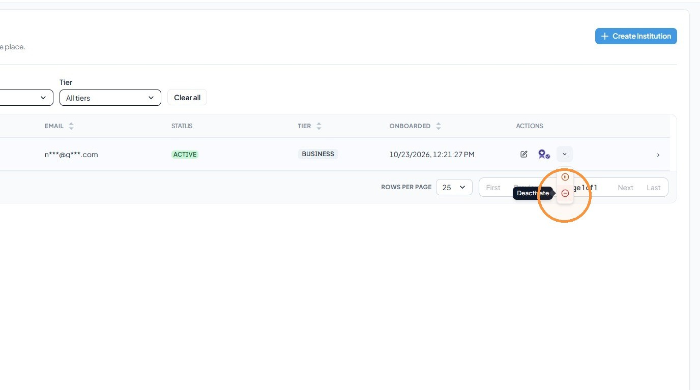

*The Deactivate action for an institution.*

- **Step 7** In the confirmation dialog, click **Update** to deactivate the institution.

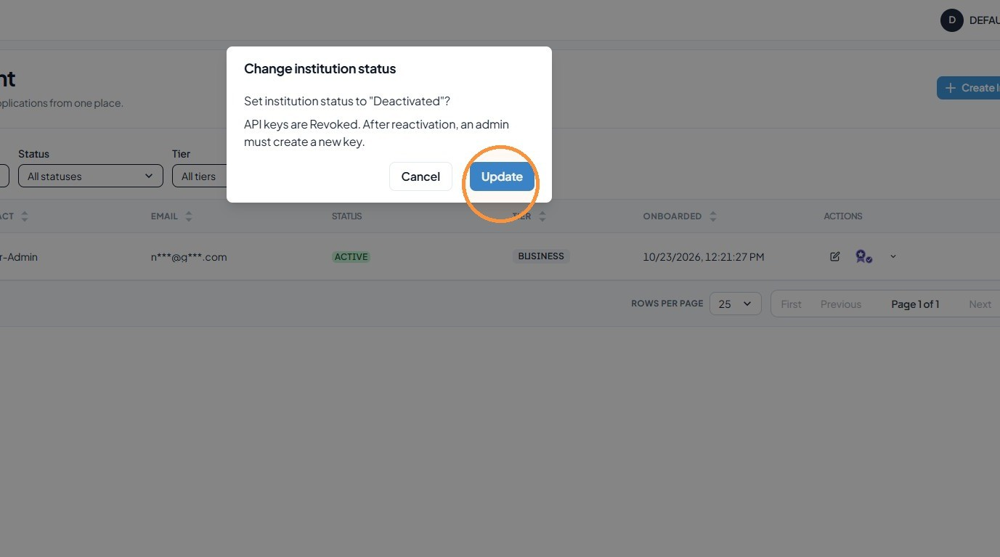

*The deactivation confirmation.*

- **Outcome:** The institution’s status is updated to reflect the action you confirmed.

- **Next:** Continue to Create & Manage Applications.

## 13. Create & Manage Applications

- **Objective:** Register an application under your organization and manage its share of your organization’s budget.

- **Role:** Adopter Admin

- **Prerequisites:**
  - Your organization has an assigned tier and budget.
  - You have the application’s name. You can also provide a description, domain, and budget allocation percentage.

- **Step 1** In the left navigation, click **Institution Management**. Then open your organization, shown as **default organisation**.

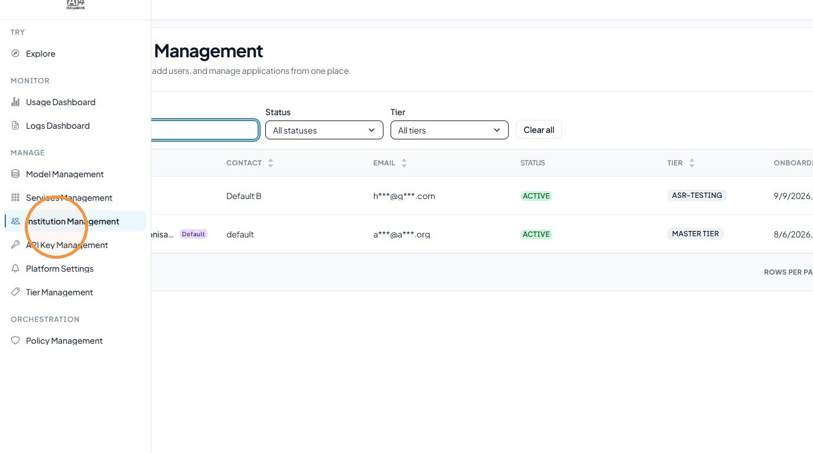

*Institution Management in the left navigation.*

- **Step 2** Click the **Applications** tab to see your organization’s applications and budget allocation.

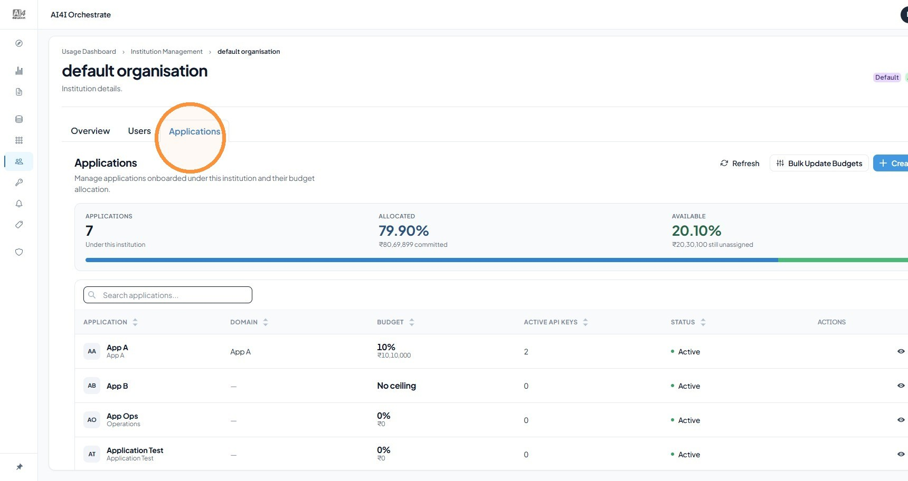

*Your organization’s Applications tab.*

- **Step 3** Click **Create Application** to open the form.

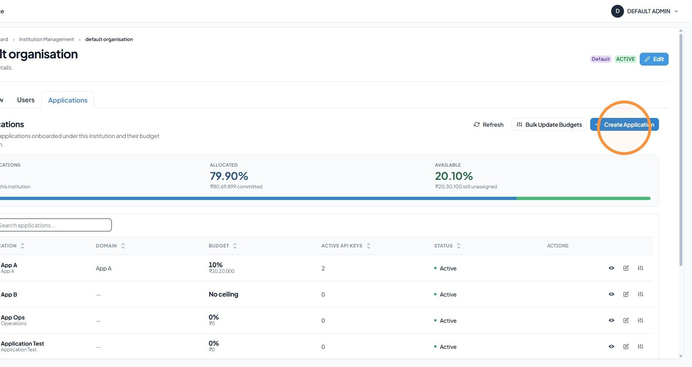

*The Create Application button.*

- **Step 4** Enter the **Application Name**. Add a **Description**, **Domain**, and **Budget Allocation** if needed, then click **Create Application**.

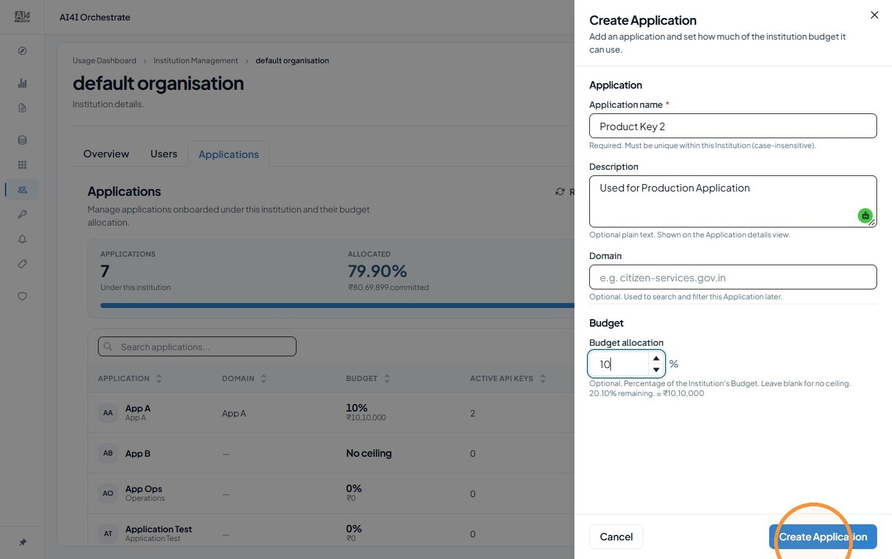

*The application details and optional budget allocation.*

- **Step 5** To change an application’s budget allocation, click the **Edit Budget** sliders icon next to the application.

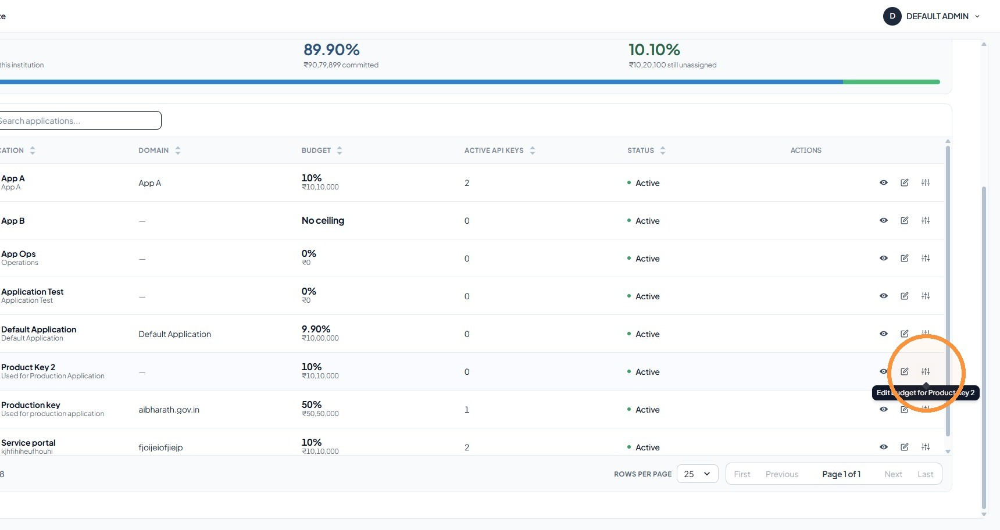

*The Edit Budget action for an application.*

- **Step 6** Review the **Allocated**, **Consumed**, and **Remaining (Institution)** amounts. Enter the new percentage within the **Allowed Range**, then click **Save Changes**.

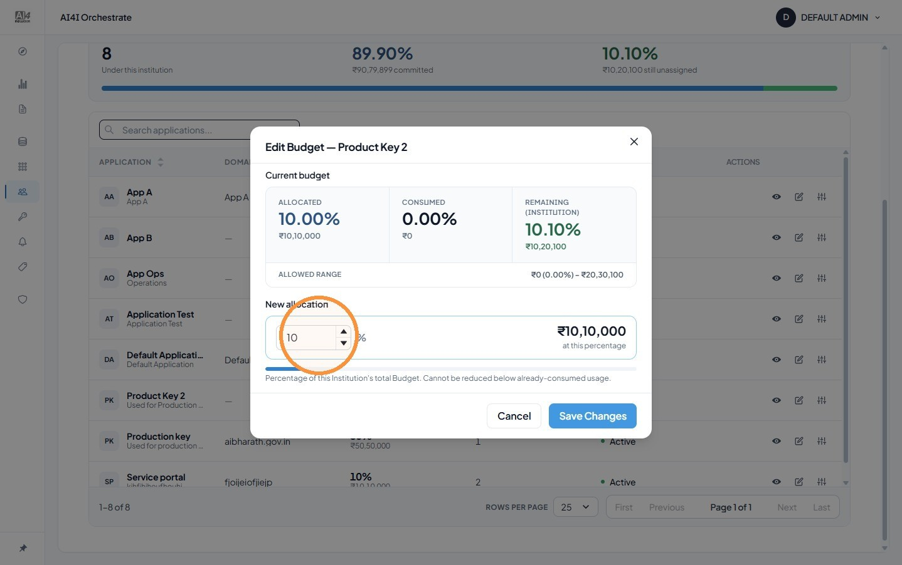

*Entering the application’s new budget allocation.*

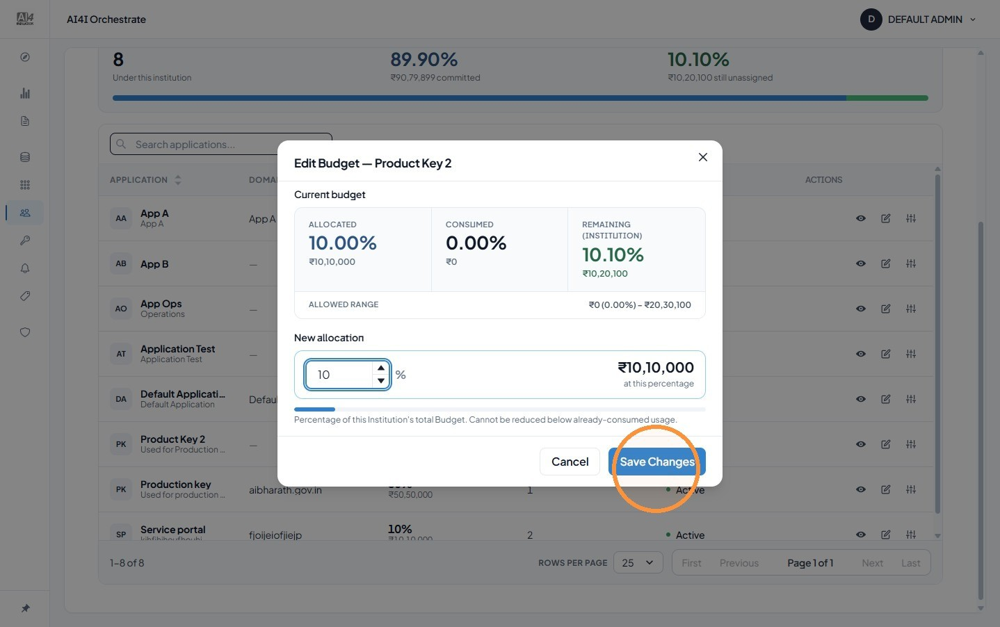

*Saving the application’s budget allocation.*

- **Step 7** To view an application’s current allocation, click the view icon next to it. You can see both the budget percentage and the corresponding amount.

- **Outcome:** The application is registered under your organization. You can view its budget allocation and adjust it as needed.

- **Next:** Continue to Create & Manage API Keys.

## 14. Create & Manage API Keys

- **Objective:** Create API keys for your organization’s applications, update their details, adjust their budgets, or revoke them.

- **Role:** Adopter Admin

- **Prerequisites:**
  - The application that will use the key has been created.
  - You have decided the key’s permissions, budget allocation, and expiry.

- **Step 1** In the left navigation, click **API Key Management**.

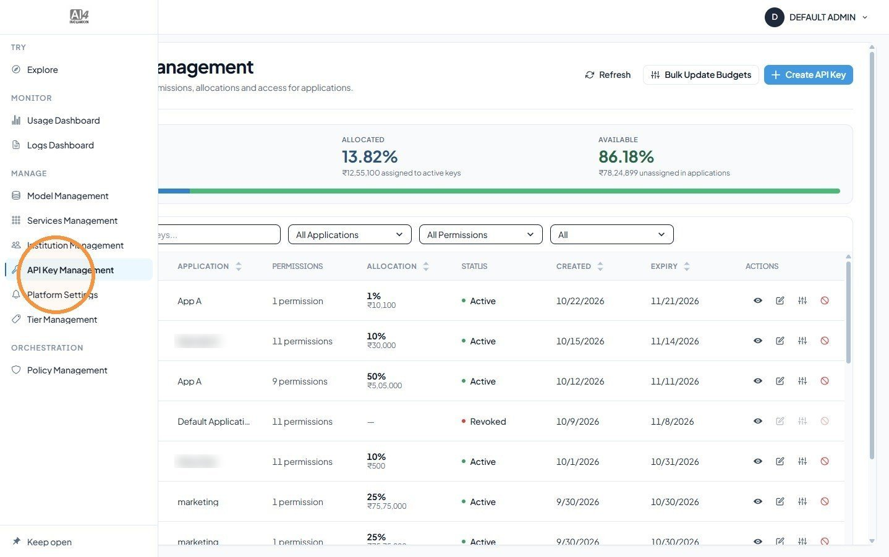

*The API Key Management page.*

- **Step 2** Click **Create API Key** to open the form.

*The Create API Key button.*

- **Step 3** Enter a **Key Name**, select the **Application** that will use the key, and choose the **Permissions** it needs.

*The key name, application, and permissions.*

- **Step 4** Enter the required **Budget Allocation** as a percentage of the application’s budget. Set the **Expiry (Days)** between 1 and 365, then click **Create API Key**.

*The key’s budget allocation and expiry.*

- **Step 5** Copy the generated key and store it securely before leaving this screen. The full key is shown only once. If you lose it, revoke the key and create a new one.

*The generated API key, shown once.*

- **Step 6** Return to **API Key Management** to view your existing keys. Use the **Key Name**, **Application**, **Permission**, and **Status** filters to find the keys you need.

*Existing API keys and the available filters.*

- **Step 7** To adjust the budget allocated to an application’s existing keys, click **Bulk Update Budgets**.

*The Bulk Update Budgets button in API Key Management.*

- **Step 8** Select the **Application**, then change the **Allocation** percentage for the keys you want to update. **Budget (INR)** updates automatically as you change the percentage. Click **Save All Changes** when you are done.

*The application selected in Bulk Update Budgets.*

*The updated allocation percentage and corresponding budget amount.*

*Saving all API key budget changes.*

- **Step 9** To rename a key or change its permissions, click the edit icon next to it.

*The edit action for an API key.*

- **Step 10** Update **Key Name** or **Permissions**, then click **Save Changes**. You cannot change the key’s application, budget, or expiry in this dialog.

*Saving changes to the key name and permissions.*

- **Step 11** To revoke a key, click the revoke icon next to it.

*The revoke action for an API key.*

- **Step 12** In the confirmation dialog, review the allocated and consumed amounts and the unused budget that will return to the application. Click **Revoke API Key** to confirm.

*The key revocation confirmation.*

- **Outcome:** A newly created key is ready to authenticate requests. Budget changes and edits are saved to the selected keys. If you revoke a key, it stops authenticating requests immediately.

- **Next:** Continue to Manage Tiers.

## 15. Manage Tiers

- **Objective:** View a tier, update its details, schedule a quota change, deactivate or reactivate it, or delete it.

- **Role:** Adopter Admin

- **Prerequisites:** At least one tier exists.

- **Step 1** In the left navigation, click **Tier Management**.

*The Tier Management page.*

- **Step 2** To view a tier’s details, click its name.

*The tier name used to open its details.*

- **Step 3** To change the tier’s name, description, rate limit, or quota, click the edit icon next to it.

*The edit action for a tier.*

- **Step 4** In the edit form, update the **Tier Name**, **Description**, or **Rate Limit (per minute)** as needed. To change an existing quota, click the schedule icon next to the quota, enter the new limit, and click **Confirm Schedule**. Click **Save Changes** to save your updates.

*The Schedule a change icon next to the quota.*

*The new quota limit and Confirm Schedule button.*

- **Step 5** To deactivate an **Active** tier, click the **Deactivate** icon in its **Actions** column.

*The Deactivate action for an Active tier.*

- **Step 6** In the confirmation dialog, click **Deactivate**. The tier status changes to **Deactivated**.

*The Deactivate Tier confirmation.*

- **Step 7** To reactivate a deactivated tier, click the **Activate** icon in its **Actions** column.

*The Activate action for a Deactivated tier.*

- **Step 8** In the confirmation dialog, click **Activate**. The tier status changes to **Active**.

*The Activate Tier confirmation.*

- **Step 9** To delete a tier, first deactivate it as described in Steps 5 and 6. Then click the **Delete** icon in its **Actions** column.

*The Delete action for a Deactivated tier.*

- **Step 10** In the confirmation dialog, click **Delete**. Deletion cannot be undone.

*The Delete Tier confirmation.*

- **Outcome:** Your changes are saved to the tier, a quota change is scheduled, the tier status is updated, or the tier is deleted, depending on the action you took.

- **Next:** Continue to Manage Models.

## 16. Manage Models

- **Objective:** Check a registered model’s status, deprecate it, or reactivate a deprecated model.

- **Role:** Adopter Admin

- **Prerequisites:** At least one model is registered.

- **Step 1** In the left navigation, click **Model Management**.

*The Model Management page.*

- **Step 2** In the model list, review each model’s name, version, task type, and status. Use the search and filters to find a model.

*Model names, versions, task types, and statuses in Model Management.*

- **Step 3** To deprecate a model, click the **toggle** next to it.

*The toggle for deprecating a model.*

- **Step 4** In the confirmation dialog, click **Confirm**.

*The model deprecation confirmation.*

- **Step 5** To reactivate a deprecated model, click the **toggle** next to it.

*The toggle for reactivating a deprecated model.*

- **Step 6** In the confirmation dialog, click **Confirm**.

*The model activation confirmation.*

- **Outcome:** Model Management shows the model’s updated status as Deprecated or Active.

- **Next:** Continue to Manage Services.

## 17. Manage Services

- **Objective:** View a service, edit its settings, publish or unpublish it, or delete it.

- **Role:** Adopter Admin

- **Prerequisites:** At least one service exists.

- **Step 1** In the left navigation, click **Services Management**.

*The Services Management page.*

- **Step 2** In the services list, click a service’s name to see its configuration.

*The services list and service name used to open its configuration.*

- **Step 3** To change the service’s settings, click the edit icon next to it.

*The edit action for a service.*

- **Step 4** Update the endpoint, authentication token, hardware description, pricing, or mapped tiers as needed. For LLM services, review the input, cached input, and output token prices for the selected unit size. Click **Save Changes**.

*Authentication, hardware, LLM token pricing, and tier settings.*

- **Step 5** To unpublish a service, click the unpublish icon next to it.

*The unpublish action for a service.*

- **Step 6** In the confirmation dialog, click **Confirm** to unpublish the service.

*The confirmation to unpublish a service.*

- **Step 7** To publish an unpublished service, click the publish icon next to it.

*The publish action for a service.*

- **Step 8** In the confirmation dialog, click **Confirm** to publish the service.

*The confirmation to publish a service.*

- **Step 9** To delete a service, first unpublish it as described in Steps 5 and 6, then click the delete icon next to it. Deletion cannot be undone.

- **Outcome:** Your changes are saved to the service. Publishing makes it available for access; unpublishing stops access. If you delete the service, it is removed permanently.

- **Next:** Continue to Onboard Adopter Users.

## 18. Onboard Adopter Users

- **Objective:** Add Adopter Users to your organization, or let them register themselves.

- **Role:** Adopter Admin

- **Prerequisites:** Your organization is available in Institution Management.

- **Step 1** In the left navigation, click **Institution Management**.

*The Institution Management page.*

- **Step 2** Click your organization’s name, shown as **default organisation**.

*Opening your organization from Institution Management.*

- **Step 3** Open the **Users** tab, then click **Add User**.

*The Users tab and Add User button.*

- **Step 4** Enter the user’s **Email** and **Full Name**, select their **Role**, and add a **Phone Number** if available. Agree to the **Terms of Service** and **Privacy Policy** on their behalf, then click **Add User**.

*The new user’s details and role.*

If the user is registering their own account, they can follow the sign-up step below.

- **Step 5** The user opens the **Sign-Up** page, enters their full name and email address, enters and confirms their password, and agrees to the Terms of Service and Privacy Policy. They then click **Sign Up** to submit their registration.

*The Sign-Up page for users registering themselves.*

To assign or change a user’s role after registration, follow Manage User Roles in Manage Your Profile.

- **Outcome:** The user has been added or has submitted their registration. Review their role and account status in your organization’s Users tab.

- **Next:** Continue to Manage Your Profile.

## 19. Manage Your Profile

- **Objective:** Update your profile details, change your password, manage user roles, or sign out.

- **Role:** Adopter Admin

- **Prerequisites:** You are signed in. To manage another user’s role, that user must already exist.

- **Step 1** Open the menu in the top-right corner, then click **Profile**.

*The Profile option in the top-right menu.*

- **Step 2** On the **User Details** tab, review your profile. Click **Edit** to change the editable fields. Your username and email address cannot be changed here.

*Your user details on the Profile page.*

- **Step 3** To change your password, click the **Change Password** tab. Enter your **Current Password** and **New Password**, then enter the new password again in **Confirm New Password**. Click **Update Password**.

*The Change Password tab and password requirements.*

### Manage User Roles

- **Step 4** To assign or change a user’s role, click the **Roles** tab on the **Profile** page.

*The Roles tab in Profile.*

- **Step 5** Select the user from the dropdown, then click **Manage Roles**.

*The selected user and Manage Roles option.*

- **Step 6** Choose the role you want to assign, then click **Save Changes**.

*The role selected for the user.*

### Sign Out

- **Step 7** To end your current session, open the menu in the top-right corner and click **Sign out**.

*The Sign out option in the top-right menu.*

- **Outcome:** Your profile details, password, or user roles are updated. If you sign out, your current session ends.

- **Next:** Continue to the Logs Dashboard.

## 20. Logs Dashboard

- **Objective:** Review requests across institutions and open a request’s trace to see its details.

- **Role:** Adopter Admin

- **Prerequisites:** At least one request has been made on the platform.

- **Step 1** In the left navigation, click **Logs Dashboard**.

*The Logs Dashboard page.*

- **Step 2** You can see total, successful, and failed requests. Use **Search**, **Institution**, **Task Type**, **Status**, **End User**, **Metadata**, or the start and end times to find a request. Click the view icon next to it to open its trace.

*Request totals, filters, and the view trace action.*

- **Step 3** Review the **Trace ID**, service, institution, environment, and individual spans. Check each span’s timestamp, duration, status, and attributes to investigate the request.

*The selected request’s trace details and spans.*

- **Outcome:** You can review requests across the platform and use the filters to find and inspect a specific request.

- **Next:** Continue to Try It Now.

## 21. Try It Now

- **Objective:** Explore the available model task types and try a service directly in the portal.

- **Role:** Adopter Admin

- **Prerequisites:** At least one service is published.

- **Step 1** In the left navigation, click **Explore** to open the **AI Accessibility Studio**, which shows the available model task types.

*The Explore page with the available model task types.*

- **Step 2** Click **Try it now** on the task type you want to test. For this example, choose **Large Language Model (LLM)**.

*The Try it now button on the LLM card.*

- **Step 3** Select an available service from the **LLM Service** dropdown. The service name and description appear below it.

*The selected LLM service and its details.*

- **Step 4** Choose the **Source Language** and **Target Language**, then enter your text in **Source Text**. For example, select English and Hindi and enter “How far is MG Road from here”. Click **Translate** to run the request.

*The source and target languages, input text, and Translate button.*

- **Step 5** Review the translated text under **Output**. Use the copy icon to copy it. The screen also shows the request word count, response word count, and response time. Click **Clear Results** to clear the result.

*The translation output, copy action, word counts, and response time.*

- **Outcome:** You can test a model through its available service directly in the portal. This example shows an LLM service translating text from English to Hindi.
